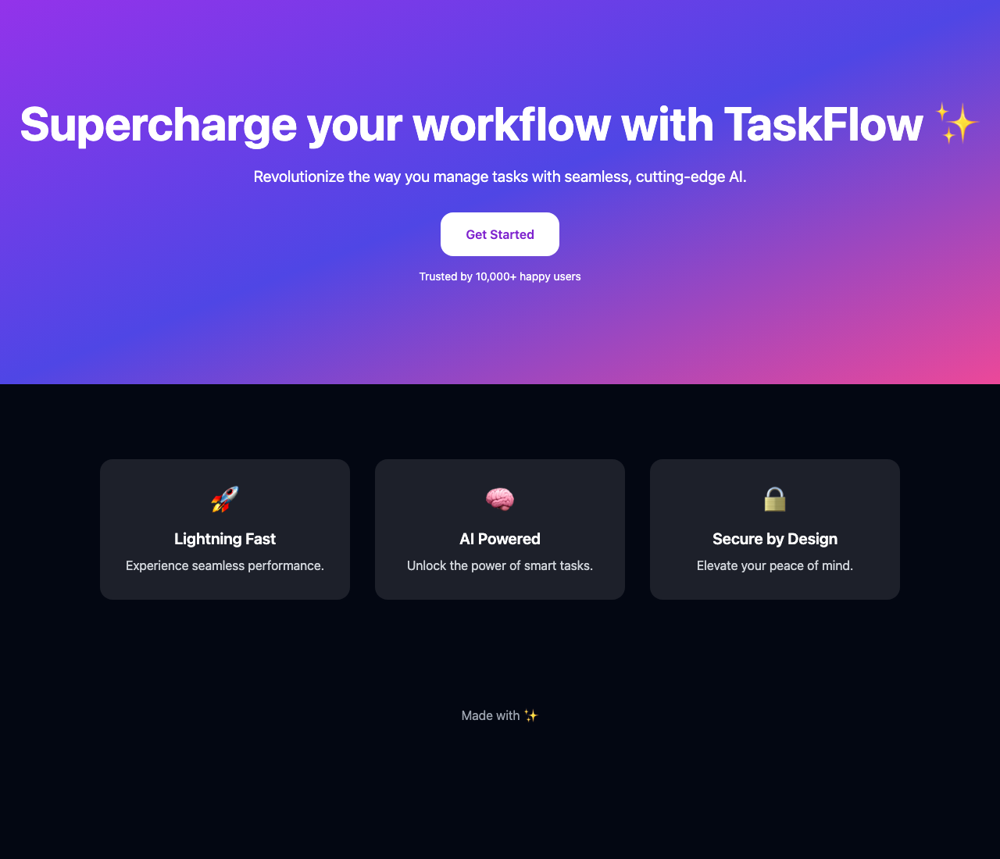
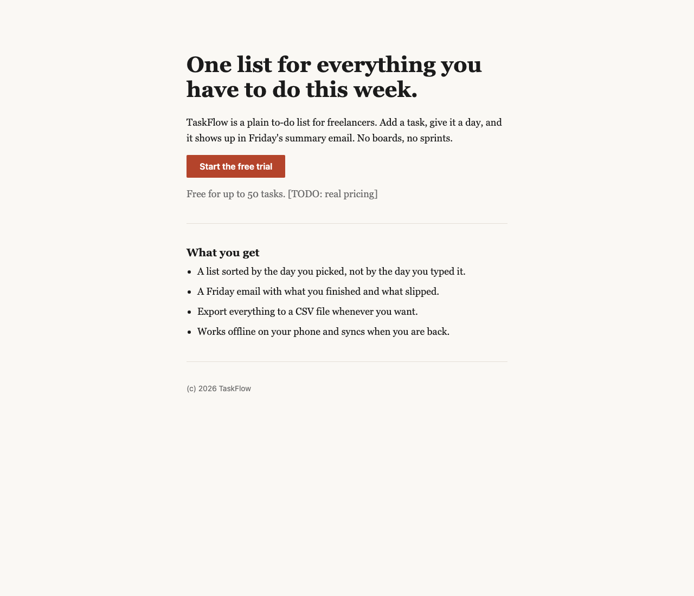

# clean-design

An AI coding agent skill that stops your AI-built site from looking "vibe coded".

A vague prompt ("make it look professional") gets you the average of the internet: purple gradient, emoji icons, three identical cards, "Supercharge your workflow". This skill makes the agent write a short design brief first, build with constraints, **check its own output with 13 scripted tools**, then get a fresh-eyes review.

From the @devvsclawd reel "Looks vibe coded".

## The 13 tools
Run with `node clean-design/scripts/cd.mjs <tool> <path>`:

| Tool | What it does |
|---|---|
| `scan` | AI tells scored 0 to 10 (purple gradient, stock words, emoji and sparkles, glass blur, fake stats, identical card rows, too many accent colors, big radius everywhere, everything centered) |
| `contrast` | text and background pairs under 4.5:1, resolves CSS variables |
| `scale` | a type scale as CSS variables from a base size and ratio |
| `tokens` | a `tokens.css` from a preset (editorial, utility, warm); warns if your accent fails contrast |
| `copy` | stock phrases, each with a better way to say it |
| `spacing` | margins and padding off the 4 px scale |
| `a11y` | missing lang, alt text, labels, extra h1, skipped heading levels |
| `fonts` | more than two font families |
| `placeholders` | lorem ipsum, dummy names, placeholder image URLs |
| `responsive` | missing viewport meta, fixed widths with no max-width |
| `shot` | headless screenshot for before and after pairs |
| `report` | runs the checks, gives one **Clean score 0 to 100** |
| `pack` | bundles page, brief and audit prompt for a fresh-eyes review |

Plus four modes in `SKILL.md` (brief, build, rescue, audit), three style presets, a brief template, copy swaps and an audit prompt.

## Install
```bash
git clone https://github.com/hollermay/clean-design.git
cp -R clean-design/clean-design ~/.claude/skills/clean-design
```
Then ask your agent: "use clean-design to build my landing page" or "rescue my site with clean-design". Needs Node 18+; `shot` needs Chrome or Chromium.

## Example (examples/)
Same product, same page, two prompts.

| `before.html` ("make it look professional") | `after.html` (with the skill) |
|---|---|
|  |  |

Clean score: before **50 / 100** (7 of 10 AI tells), after **100 / 100**. Full reports: `examples/before-report.md`, `examples/after-report.md`.

## Honest limits
- The tools find mechanical problems only. A score of 100 means the known tells are gone, not that the design is good. Taste, hierarchy and photo quality need the fresh-eyes audit.
- Styles that live only in utility classes (for example Tailwind) are not parsed by `contrast`, `spacing` or `fonts`; `scan` reads them.
- The before/after pair was written by the author in one sitting, not a blind test across many models. Treat it as an illustration.

MIT licensed.
